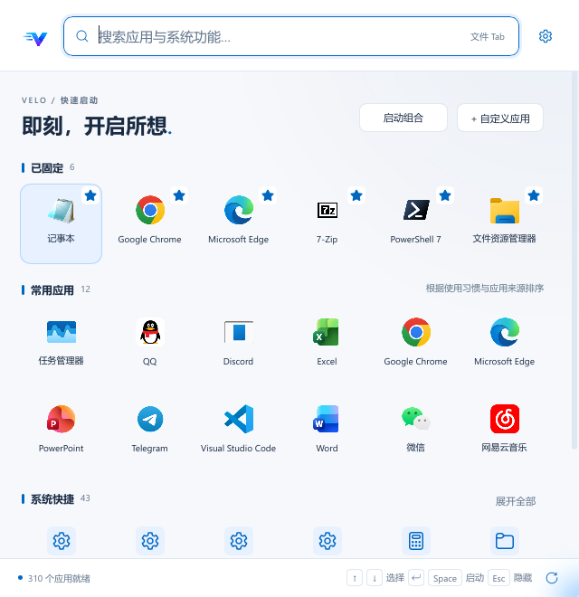
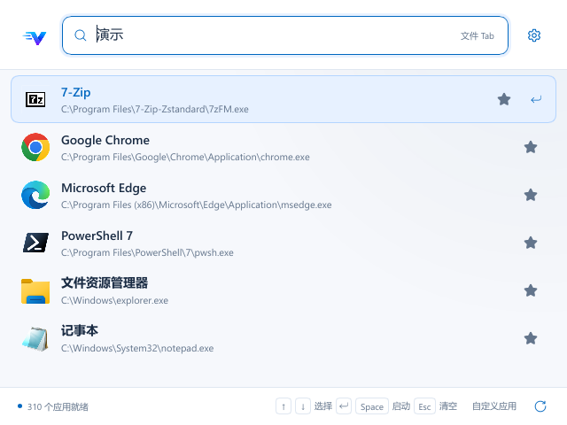
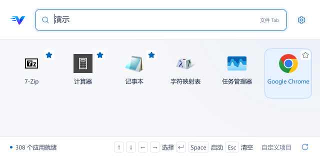
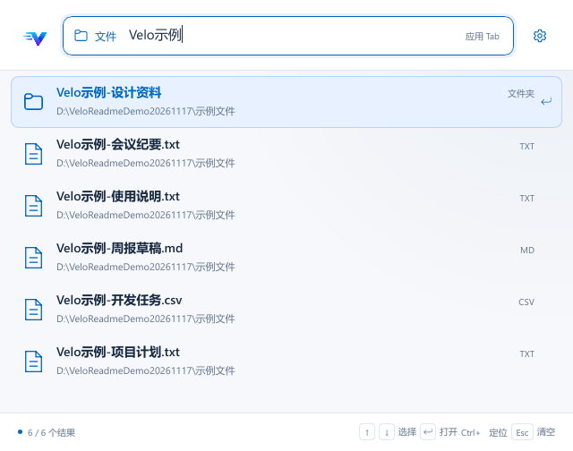
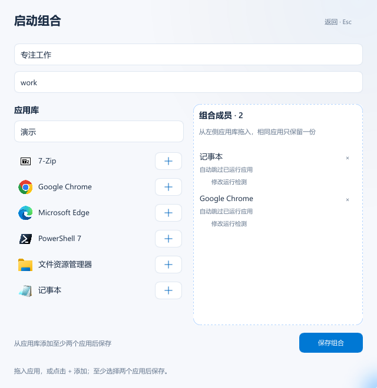
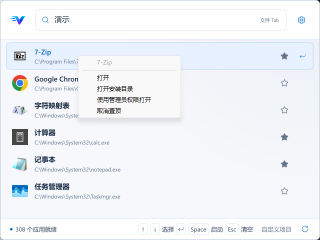
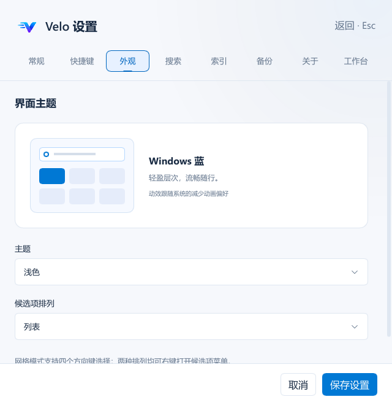
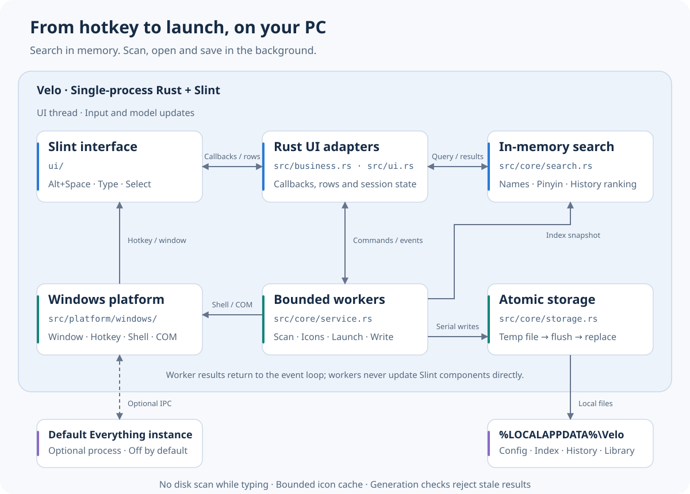

<p align="center">
  
</p>

<h1 align="center">Velo</h1>
<p align="center"><strong>Fast. Light. Ready.</strong><br />Press a shortcut. Find your app. Launch.</p>
<p align="center"><a href="README.md">简体中文</a> · <strong>English</strong></p>
<p align="center">
  <a href="https://github.com/HBLADEH/velo-launcher/actions/workflows/ci.yml?query=branch%3Amain"></a>
  <a href="LICENSE"></a>
  
  
</p>
<p align="center">
  <a href="https://github.com/HBLADEH/velo-launcher/releases">Download</a> ·
  <a href="#quick-start">Quick start</a> ·
  <a href="#how-velo-works">How it works</a> ·
  <a href="docs/user-guide.md">User guide (中文)</a> ·
  <a href="CONTRIBUTING.md">Contribute</a> ·
  <a href="https://github.com/HBLADEH/velo-launcher/issues">Report an issue</a>
</p>

Velo is an application launcher for **Windows 10 / 11 x64**, built with **Rust + Slint** and a Simplified Chinese interface. Press `Alt+Space`, search by name, Chinese pinyin or initials, and press `Enter`. Pinned apps, frequently used apps and Windows shortcuts share one window.

The native UI and application logic run in a single process. Settings, the app index and usage history stay on your computer. Choose a list or icon grid and a light or dark theme. This page accompanies the [primary Chinese documentation](README.md).

> **v0.11.0** adds Everything file search and launch groups. Installers are currently unsigned. See the [v0.11.0 release notes (Chinese)](docs/releases/0.11.0.md).

## Screenshots

Actual Windows captures of the **0.11.0 Software development build**, using an independent demo configuration, pins and usage records. Everything is enabled for this demo; integration is disabled by default. Images retain their captured pixel dimensions and are stored as PNG. See the [capture notes](docs/images/README.md) for build identity and all scenes. The interface is in Chinese.

<p align="center">
  <picture>
    <source media="(prefers-color-scheme: dark)" srcset="docs/images/home-dark.png" />
    <source media="(prefers-color-scheme: light)" srcset="docs/images/home-light.png" />
    
  </picture>
</p>
<p align="center"><em>Home brings pins, frequent apps and Windows shortcuts together. Scroll to see more.</em><br /><a href="docs/images/home-light.png">View light theme</a> · <a href="docs/images/home-dark.png">View dark theme</a></p>

<table>
  <tr><th>List search</th><th>Grid search</th></tr>
  <tr>
    <td valign="top"><a href="docs/images/search-list.png"></a><br />Names, paths and icons, with arrow-key selection and Enter to launch.</td>
    <td valign="top"><a href="docs/images/search-grid.png"></a><br />The same ranking presented as an icon grid.</td>
  </tr>
  <tr><th>Everything file search · New in 0.11.0</th><th>Launch groups · New in 0.11.0</th></tr>
  <tr>
    <td valign="top"><a href="docs/images/everything-search.png"></a><br />Press Tab to search files and folders, then open, reveal or copy paths.</td>
    <td valign="top"><a href="docs/images/launch-groups.png"></a><br />Drag library apps into a named group, save, then search its name to launch.</td>
  </tr>
  <tr><th>Native context menu</th><th>Appearance settings</th></tr>
  <tr>
    <td valign="top"><a href="docs/images/context-menu.png"></a><br />Open installation folders, run as administrator or manage pins.</td>
    <td valign="top"><a href="docs/images/appearance.png"></a><br />Choose a theme and result layout, then save.</td>
  </tr>
</table>

Custom apps, configuration backup, the file-search toggle and version-page captures are included in the [user guide](docs/user-guide.md) and [screenshot directory](docs/images/README.md).

## Features

- **Keyboard controls**: global hotkey, arrow-key navigation and `Enter` to launch, with hotkey recording, focus-loss hiding and tray access.
- **Window and session**: drag the logo, title or empty header area to move the window. Hiding preserves the current page, search, unsaved settings and update progress.
- **Application search**: Chinese, English, pinyin, initials, keywords, fuzzy matching and single-character typo tolerance. Ranking considers launch frequency, recent use and query history.
- **Automatic indexing**: discovers Start menu, desktop, Windows Apps, Program Files and custom-directory apps; merges duplicates and optionally filters uninstall, help and update utilities.
- **Quick access**: pins and frequently used apps on home, plus Windows shortcuts searchable by Chinese, English, pinyin and abbreviations.
- **Result actions**: ranked list and grid views; context menus can launch, open the installation directory, run as administrator or pin an app.
- **Custom apps**: drop files, select files or paste paths to add `.exe` / `.lnk` entries outside scanned directories. Custom entries and home pins are managed separately.
- **Appearance and preferences**: light, dark or system theme, list or grid layout, login startup, result limits, ranking weights and index refresh settings.
- **Local data and backups**: background index refresh, visible-range icon loading with a cache budget, and backups of saved configuration.
- **Updates**: GitHub Releases checks, SHA-256 verification, configuration backup before installation, and system-installer upgrades that preserve settings.

**New in 0.11.0**

- **Everything file search**: enable and save in Settings / Search, then press `Tab` to switch modes. Supports names, paths, Everything syntax, opening, revealing, copying paths and pagination. Disabled by default; requires an installed and running default Everything instance. See the [guide](docs/user-guide.md#everything-文件搜索).
- **Launch groups**: name a group, drag at least two members from the app library with icons, save, then search the group name to open its members. Running apps are skipped, with per-member results and retry actions. See the [guide](docs/user-guide.md#启动组合).

## Download and install

Get a Windows x64 system installer from the [latest release](https://github.com/HBLADEH/velo-launcher/releases/latest):

- **Default**: `velo-rust-x64-installer.exe`, using the Software renderer.
- **Alternative**: `velo-rust-femtovg-x64-installer.exe`, using FemtoVG / OpenGL.

Run the installer and approve Windows UAC. Exit Velo from its tray before upgrading or switching renderers. Current releases provide system installers; release ZIPs contain installation payloads and cannot run as portable applications.

Releases include `SHA256SUMS.txt`, a dependency license archive and a build manifest. Use `Get-FileHash -Algorithm SHA256` to verify the installer. Windows 10 / 11 x64 is required; macOS and Linux are unsupported.

Data lives in `%LOCALAPPDATA%\Velo`. Before initial data-store setup, Velo preserves the original data under the sibling `VeloRustMigrationBackups` directory; backup failure stops initialization. Uninstall preserves user data and program recovery archives. Earlier-version users should follow the [v0.10.0 migration instructions](docs/releases/0.10.0.md).

## Quick start

1. Install and start Velo. Wait for the first index; subsequent starts use the cache first.
2. Press `Alt+Space` and type an app name such as `code`, Chinese text, pinyin or initials.
3. Select a result with the arrow keys and press `Enter`. Use the star button to pin an app to home.
4. Press `Ctrl+,` to open settings, adjust the hotkey, theme, search preferences or index directories, then save.

Common controls:

- **Show / hide**: `Alt+Space`, configurable in Settings / Hotkeys.
- **Select**: `↑` / `↓`; home and grid views also support `←` / `→`.
- **Launch**: `Enter`; `Space` is also enabled by default.
- **Clear / return / hide**: `Esc`, according to the current page and input state.
- **Result menu**: right-click or `Shift+F10`.
- **Settings**: `Ctrl+,` or the gear button. Backups are under Settings / Backup; updates are under Settings / About.
- **Exit completely**: right-click the Velo tray icon and choose Exit.

For queries containing spaces, such as `visual studio`, disable space-to-launch in Settings / General. During IME composition, confirmation, spaces, arrows and `Esc` go to the input method first. Space always types a space in Everything file mode.

An optional setting suppresses the hotkey while another app is fullscreen; tray access remains available. See the [Chinese user guide](docs/user-guide.md) for more operations, storage details and troubleshooting.

## How Velo works

Velo builds an application catalog in the background, searches it in memory as you type, and asks Windows to open the selected result. **Slint handles the interface, Rust coordinates the application, and the Windows platform layer handles system integration.**

<p align="center">
  
</p>

### Responsibilities

- **Interface**: [ui/](ui/) defines pages, components, themes and motion. [src/ui.rs](src/ui.rs), [src/business.rs](src/business.rs) and related adapters connect Slint models and callbacks to application state.
- **Application and data**: [src/core/](src/core/) handles configuration, search, history, app libraries, indexing, launch groups, file queries and updates. [service.rs](src/core/service.rs) coordinates bounded workers and snapshots.
- **Windows integration**: [src/platform/windows/](src/platform/windows/) owns window, IME, hotkey, tray, Shell, COM, icon and installation/update system calls.
- **Entry point**: [src/main.rs](src/main.rs) parses arguments, assembles components and starts the event loop. Slint pages and fixed resources are embedded at build time.

### One search, from startup to launch

1. **Build the catalog**: read configuration, cached apps, library and history; scan app sources in the background, merge and filter entries, pre-normalize names, keywords and pinyin, then publish an in-memory snapshot.
2. **Find an app**: the search callback queries [search.rs](src/core/search.rs) and sends the required display rows back to Slint. Typing does not scan disk or extract icons. Visible icons are requested separately under a cache budget.
3. **Launch and record**: a background task asks Windows Shell to open the selected item. Accepted requests are recorded in history for future rankings and frequent apps; failures preserve existing data and display a notice.

Scanning, Shell metadata, icon extraction and writes run in the background. Results return through the Slint event loop; generation checks and similar guards reject stale work. JSON writes use a same-directory temporary file, flush and atomic replacement, publishing new state after success.

Everything is an optional external search service connected on demand through Windows IPC. Disabling integration leaves no file-query worker. File results have their own model and are not saved into the app library or app usage history. See the [diagram notes](docs/diagrams/README.md) for editing and regeneration.

## Development and builds

The repository root contains a single Cargo application. Development requires **Windows x64, PowerShell 7.4+, Rust 1.99.1, MSVC 14.50.35717 and Windows SDK 10.0.26100.0**. Exact versions are locked by `rust-toolchain.toml`, `windows-toolchain.json` and `Cargo.lock`; follow the [development guide (Chinese)](docs/development.md).

```powershell
git clone https://github.com/HBLADEH/velo-launcher.git
cd velo-launcher

# Build and start an isolated preview; open it with Ctrl+Alt+K
./scripts/run-preview.ps1 -Build

# Formatting, clippy, tests, Release builds and UI smoke tests for both renderers
./scripts/verify-rust.ps1 -Product -SmokeTest
```

Product builds go into `target/product-artifacts/`; preview data lives in `.dev-data/`. Use independent instance IDs, data directories and hotkeys where needed; never test against installed product data. Run `./scripts/clean.ps1` to clear build caches. Preview builds using `-SkipChecks` do not count as complete validation.

```text
src/                 Rust entry point, UI adapters, core and Windows platform layer
ui/                  Slint pages, components, themes and fixed assets
tests/               Behavior, data, discovery and page regression tests
examples/            Explicit native validation and measurement helpers
windows/             PE manifest, NSIS installers and installation transactions
licenses/            Third-party terms and provenance
scripts/             Build, preview, test, package and measurement entry points
docs/                User/developer guides, releases and validation evidence
```

## Documentation

The following guides are primarily in Chinese:

- [User guide](docs/user-guide.md): custom apps, file search, launch groups, backups, updates and troubleshooting.
- [Development guide](docs/development.md): prerequisites, preview, validation, cleanup and packaging.
- [Rust engineering](docs/rust-engineering.md): modules, thread boundaries, instance isolation and compatibility contracts.
- [Windows shortcuts](docs/system-shortcuts.md): available entries and Windows compatibility.
- [Validation](docs/verification.md): automated checks and manual-test scope.
- [Documentation index](docs/README.md): current feature notes, releases and historical acceptance records.

## Project status

Velo focuses on local Windows application search and launching. Plugins and cloud synchronization are not provided. Software is the default renderer; FemtoVG is an OpenGL alternative. Both are built and validated separately.

Existing release acceptance covers a Windows 11 / Intel UHD 630 host and an isolated Windows 10 guest. Other unavailable physical hardware was not tested. Renderer memory and animation cadence involve tradeoffs; conditions and limits are recorded in [validation notes](docs/verification.md) and the [baseline index](docs/baselines/README.md). No universal resource budget is promised.

## Contributing

Chinese and English bug reports, feature requests, documentation improvements and pull requests are welcome. Read the [contribution guidelines](CONTRIBUTING.md) first.

Open an [issue](https://github.com/HBLADEH/velo-launcher/issues) with the Windows version, Velo version, renderer, reproduction steps and expected/actual behavior. Remove personal paths and other sensitive information from logs and captures.

## License and acknowledgements

Velo uses the [MIT License](LICENSE). Dependencies retain their own terms.

The interface uses [Slint](https://slint.dev/) under Royalty-free 2.0 and [Microsoft Fluent UI System Icons](https://github.com/microsoft/fluentui-system-icons) under MIT. Settings / About provides the actual `AboutSlint` and third-party notices; full license texts ship in the installer and license archive. See [asset provenance](ui/assets/README.md) and [licenses/](licenses/).
