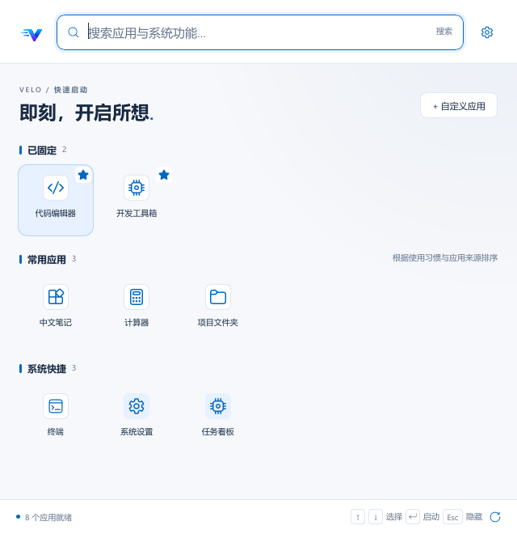

# Velo

[English](README.en.md) · [下载](https://github.com/HBLADEH/velo-launcher/releases/latest) · [用户指南](docs/user-guide.md)

面向 **Windows 10/11 x64** 的中文应用启动器。按 `Alt+Space` 呼出，输入应用名称、拼音或首字母，按 `Enter` 启动。

**Velo v0.10.0 延续 Go 0.9.x 的版本顺序，正式切换到 Rust + Slint。** 程序采用原生单进程，不需要 Go、Node.js、WebView2 或本地 HTTP 服务。Go/Wails 版本停止维护，已发布的 Rust 0.1.0 用户也可升级，见 [v0.10.0 版本说明](docs/releases/0.10.0.md)。

## 安装

从 [最新发布](https://github.com/HBLADEH/velo-launcher/releases/latest) 下载 `velo-rust-x64-installer.exe`，运行安装器并确认 Windows UAC。默认使用 Software 渲染器；`velo-rust-femtovg-x64-installer.exe` 是使用 OpenGL 的替代构建，切换前请从托盘完全退出 Velo。

提供系统安装版。发布页同时提供 `SHA256SUMS.txt`、依赖许可包和构建清单，可用 `Get-FileHash` 核对安装包。`velo-launcher-amd64-installer.exe` 是默认 Software 安装器的相同字节副本，供旧 Go 更新器识别。

官方 Go **v0.9.11 系统安装**可在“设置 → 关于”检查更新，阅读迁移说明后下载安装；正常以普通权限运行、安装目录不可写时，旧更新器使用兼容安装包原位升级。也可先从托盘退出旧 Velo，再手动运行默认安装器。其他旧构建请先卸载并保留数据，再安装；免安装版请退出后手动安装，不使用旧版“下载并安装”。迁移继续保留自定义快捷键，新安装默认 `Alt+Space`。

设置、历史、自定义应用和固定项继续位于 `%LOCALAPPDATA%\Velo`。Rust 首次打开数据前会将原文快照保存在 `%LOCALAPPDATA%\VeloRustMigrationBackups`，备份失败时停止初始化。卸载保留用户数据与程序恢复档案。

## 功能

- 中文、英文、拼音、首字母、关键词及模糊搜索，结合本地使用历史排序。
- 索引开始菜单、桌面、Windows Apps、Program Files 和自定义目录。
- 固定与常用应用、系统快捷入口、自定义应用及文件拖入。
- 列表与网格、键盘导航、原生右键菜单、托盘与全局快捷键。
- 浅色、深色、跟随系统主题、设置备份及带 SHA-256 校验的 Rust 更新。

本分支新增 **启动组合（尚未发布）**：命名后从带图标的应用库拖入成员，保存后搜索组合名称即可批量打开，并跳过已运行的成员。见[操作说明](docs/user-guide.md#启动组合本分支新增尚未发布)及[设计和验证范围](docs/launch-groups-proposal.md)。



## 开发

产品源码位于 `rust/`。工具链固定在 `rust/rust-toolchain.toml` 和 `rust/windows-toolchain.json`；请先按 [开发说明](docs/development.md) 安装匹配版本，使用 PowerShell 7.4+。

```powershell
$env:GOTOOLCHAIN = 'go1.25.6' # 仅用于历史兼容契约测试
./scripts/verify-rust.ps1 -Product -SmokeTest
```

两种渲染器分别构建到 `rust/target/product-artifacts/`。界面开发可使用独立预览身份，命令及参数见 [Rust 工程说明](rust/README.md)。测试必须使用独立实例和数据目录，不得访问正式数据。

Go/Wails 源码与旧构建脚本仅作为历史兼容测试基线保留，见 [旧版说明](docs/legacy-go-wails.md)。

## 验证与限制

[RS-14 / G4](docs/baselines/2026-11-07-slint-rs14/machine-completion-2026-11-14/g4-acceptance.md) 已在当前 Windows 11 / Intel UHD 630 宿主机和 Windows 10 测试虚拟机范围放行，其他不可用实体硬件未验证。真实搜狗输入、系统接管、故障恢复、升级、回退和卸载均有记录。

渲染器与动画存在资源和帧节奏取舍，历史性能证据见 [重构计划](docs/rust-slint-refactor-plan.md)，不承诺所有设备均达到同一内存预算。

## 贡献与许可

欢迎通过 [Issues](https://github.com/HBLADEH/velo-launcher/issues) 反馈问题，附 Windows 版本、Velo 版本和渲染器；分享记录前移除个人信息。开发约定见 [贡献指南](CONTRIBUTING.md)。

Velo 使用 [MIT](LICENSE) 许可证。第三方依赖遵循各自条款；Slint 使用 Royalty-free 2.0，应用设置 → 关于提供实际 AboutSlint，完整文本随安装器和许可包分发。[Fluent 图标](rust/ui/assets/fluent/LICENSE.txt) 使用 MIT 许可。
