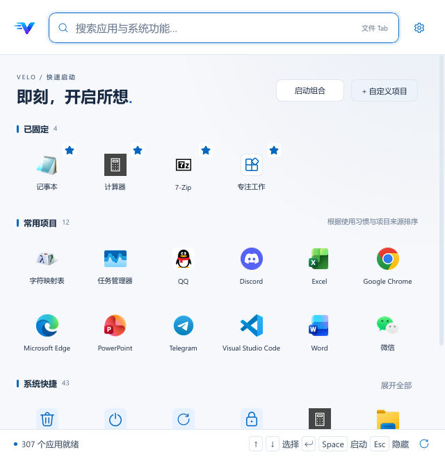
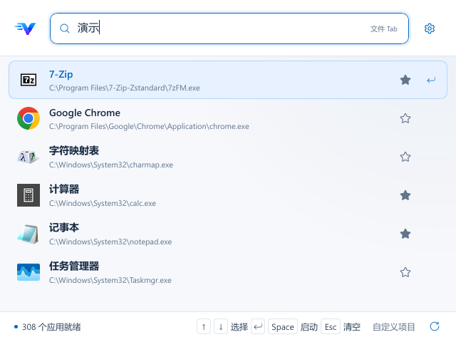
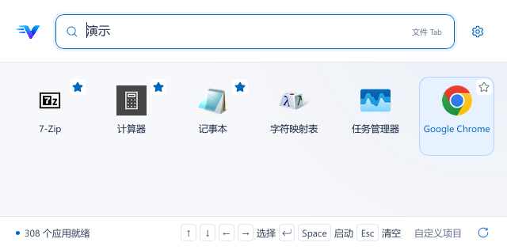
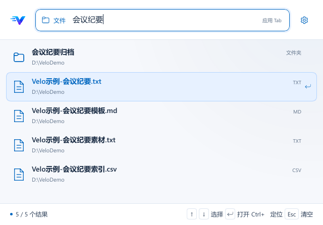
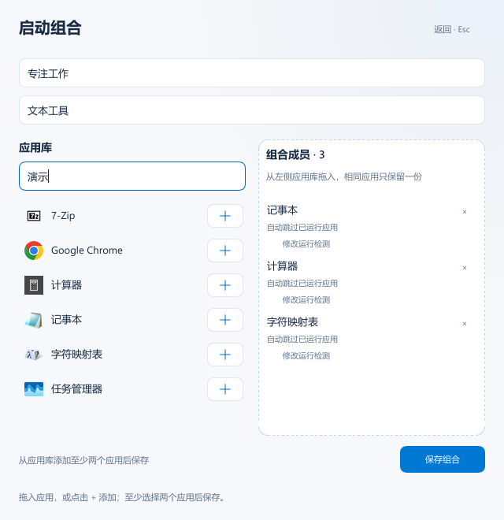
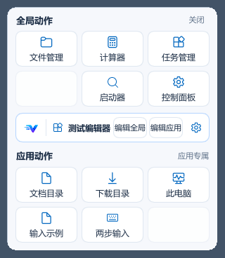
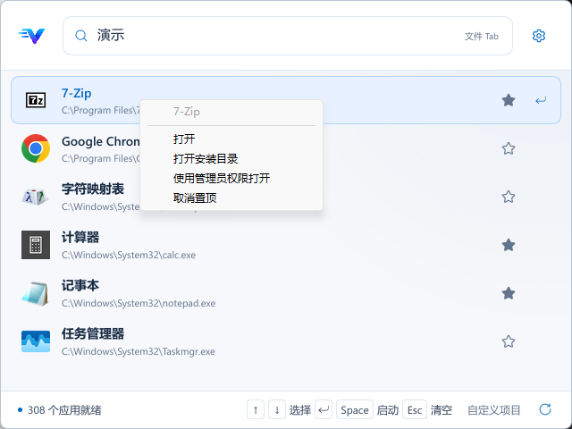
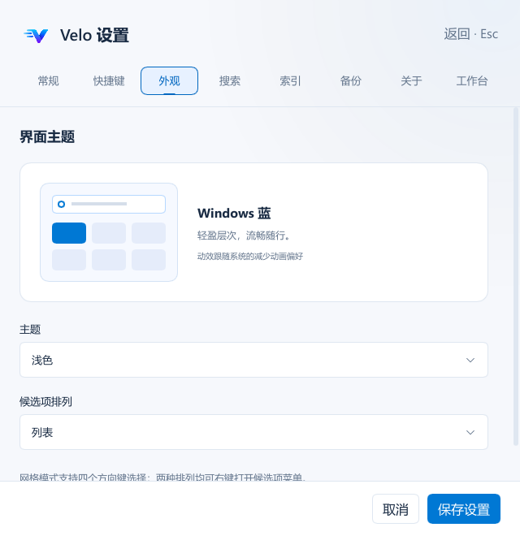
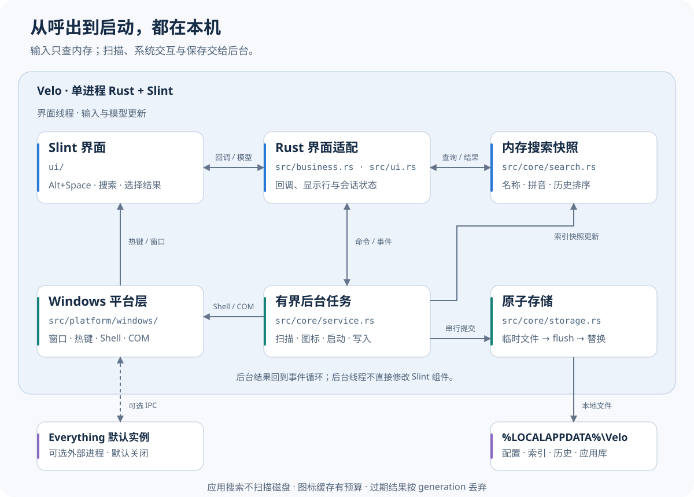

<p align="center">
  
</p>

<h1 align="center">Velo</h1>
<p align="center"><strong>按下快捷键，即刻开启所想。</strong><br /><sub>Fast. Light. Ready.</sub></p>
<p align="center"><strong>简体中文</strong> · <a href="README.en.md">English</a></p>
<p align="center">
  <a href="https://github.com/HBLADEH/velo-launcher/actions/workflows/ci.yml?query=branch%3Amain"></a>
  <a href="LICENSE"></a>
  
  
</p>
<p align="center">
  <a href="https://github.com/HBLADEH/velo-launcher/releases">下载</a> ·
  <a href="#快速上手">快速上手</a> ·
  <a href="#velo-是怎么实现的">实现原理</a> ·
  <a href="docs/user-guide.md">用户指南</a> ·
  <a href="CONTRIBUTING.md">参与贡献</a> ·
  <a href="https://github.com/HBLADEH/velo-launcher/issues">问题反馈</a>
</p>

Velo 是一款面向 **Windows 10 / 11 x64** 的中文应用启动器，使用 **Rust + Slint** 构建。按下 `Alt+Space`，输入应用名称、拼音或首字母，再按 `Enter` 启动；常用应用、首页固定项与 Windows 系统快捷集中在一个窗口中。

原生界面与业务逻辑运行在同一个进程内，设置、应用索引和使用记录保存在本机。支持列表与网格、浅色与深色主题，软件界面为简体中文；本页为主要文档，同时提供 [English README](README.en.md)。

> **v0.13.0** 更新了默认关闭的工作台（测试功能）。启动组合支持首页置顶和常用排序。安装包暂未签名。 [v0.13.0 版本说明](docs/releases/0.13.0.md)

## 界面预览

以下是 **Velo v0.13.0 Software** 的 Windows 实机截图，使用独立的演示配置与示例数据。演示中开启了 Everything 和测试版工作台。 [截图说明](docs/images/README.md)

<p align="center">
  <picture>
    <source media="(prefers-color-scheme: dark)" srcset="docs/images/home-dark.png" />
    <source media="(prefers-color-scheme: light)" srcset="docs/images/home-light.png" />
    
  </picture>
</p>
<p align="center"><em>在首页打开固定应用、启动组合、常用项目与系统快捷。</em><br /><a href="docs/images/home-light.png">查看浅色首页</a> · <a href="docs/images/home-dark.png">查看深色首页</a></p>

<table>
  <tr><th>列表搜索</th><th>网格搜索</th></tr>
  <tr>
    <td valign="top"><a href="docs/images/search-list.png"></a><br />名称、路径与图标一目了然，方向键选择、Enter 启动。</td>
    <td valign="top"><a href="docs/images/search-grid.png"></a><br />图标与名称按网格排列，支持四个方向键选择。</td>
  </tr>
  <tr><th>Everything 文件搜索</th><th>启动组合</th></tr>
  <tr>
    <td valign="top"><a href="docs/images/everything-search.png"></a><br />Tab 切换文件模式，搜索文件与文件夹，支持打开、定位和复制路径。</td>
    <td valign="top"><a href="docs/images/launch-groups.png"></a><br />从应用库拖入成员，保存后搜索组合名称即可批量打开。</td>
  </tr>
  <tr><th>工作台（测试版）</th><th>快捷盘（测试版）</th></tr>
  <tr>
    <td valign="top"><a href="docs/images/workspace-panel.png"></a><br />短按侧键打开双区矩阵。</td>
    <td valign="top"><a href="docs/images/workspace-gesture.png"></a><br />长按侧键并划向已绑定的方向，松开执行。</td>
  </tr>
  <tr><th>原生右键菜单</th><th>外观设置</th></tr>
  <tr>
    <td valign="top"><a href="docs/images/context-menu.png"></a><br />打开安装目录、以管理员权限启动，或管理首页固定项。</td>
    <td valign="top"><a href="docs/images/appearance.png"></a><br />选择主题与结果排列，保存后生效。</td>
  </tr>
</table>

更多界面原图与宣传片定帧见[截图目录](docs/images/README.md)。

## 主要功能

- **键盘操作**：全局快捷键呼出，方向键选择，`Enter` 启动；支持失焦隐藏、托盘入口和快捷键录制。
- **窗口与会话**：拖动顶部标志、标题或空白区域移动窗口。隐藏后再次呼出，保留当前页面、搜索内容、设置草稿和更新进度。
- **应用搜索**：支持中文、英文、拼音、首字母、关键词、模糊匹配和单字符拼写容错，结合启动频率、最近使用和查询历史排序。
- **自动索引**：发现开始菜单、桌面、Windows Apps、Program Files 和自定义目录中的应用；合并重复项，按设置过滤卸载、帮助、更新等辅助入口。
- **快捷访问**：应用和文件夹都可固定到首页；内置系统快捷支持中文、英文、拼音及缩写搜索。
- **候选项操作**：列表与网格共用搜索排名；右键可打开应用、打开安装目录、以管理员权限启动或置顶到首页。
- **自定义项目**：拖入、选择或粘贴路径，将文件夹和扫描范围外的 `.exe` / `.lnk` 加入搜索，再用星标固定到首页。
- **外观与偏好**：浅色、深色、跟随系统主题，列表与网格排列，以及登录启动、结果数量、搜索权重和索引刷新设置。窗口使用随主题变化的细描边，Windows 11 使用系统圆角。
- **本地数据与备份**：数据保存在本机，索引在后台更新，图标按可见范围加载；可以备份已保存的配置。
- **应用更新**：检查 GitHub Releases，下载后校验 SHA-256，安装前备份配置，通过系统安装器升级并保留原有设置。

**0.11.0 新增功能**

- **Everything 文件搜索**：在设置 → 搜索启用并保存后，按 `Tab` 切换文件模式。支持名称、路径和 Everything 语法，以及打开、定位、复制路径和分页。默认关闭，需自行安装并运行 Everything 默认实例；见[使用说明](docs/user-guide.md#everything-文件搜索)。
- **启动组合**：为组合命名，从带图标的应用库拖入至少两个成员，保存后搜索组合名称即可批量打开；跳过已运行成员，并保留逐项结果和失败重试入口。见[使用说明](docs/user-guide.md#启动组合)。

## 下载与安装

前往 [Releases](https://github.com/HBLADEH/velo-launcher/releases/latest) 下载 Windows x64 系统安装器：

- **默认安装器**：`velo-rust-x64-installer.exe`，使用 Software 渲染器。
- **替代安装器**：`velo-rust-femtovg-x64-installer.exe`，使用 FemtoVG / OpenGL 渲染器。

运行安装向导并确认 Windows UAC。升级或切换渲染器前，请从托盘完全退出 Velo。当前发行提供系统安装版；发布页的 ZIP 为安装载荷，不能作为免安装版直接运行。

发布页同时提供 `SHA256SUMS.txt`、依赖许可包和构建清单，可使用 `Get-FileHash -Algorithm SHA256` 核对安装包。系统要求为 Windows 10 / 11 x64，目前不支持 macOS / Linux。

用户数据位于 `%LOCALAPPDATA%\Velo`。首次初始化前会在同级 `VeloRustMigrationBackups` 目录保留原始数据快照，备份失败时停止初始化；卸载保留用户数据与程序恢复档案。旧版本的升级步骤见 [v0.10.0 安装与迁移说明](docs/releases/0.10.0.md)。

## 快速上手

1. 安装并启动 Velo，等待首次索引完成；后续启动优先读取缓存。
2. 按 `Alt+Space` 呼出窗口，输入应用名称，例如 `code`，也可以输入中文、拼音或首字母。
3. 使用方向键选择结果，按 `Enter` 启动；点击星标可固定到首页。
4. 按 `Ctrl+,` 打开设置，调整快捷键、主题、搜索偏好和索引目录，点击“保存设置”生效。

要添加文件夹，在首页打开“自定义项目”，拖入文件夹并导入。用星标固定后可从“已固定”快速打开。见[自定义项目](docs/user-guide.md#自定义项目)。

找不到自定义项目时，Velo 会询问是否移除该记录及对应的固定项。直接固定的项目找不到时，可以取消固定。

常用操作：

- **显示 / 隐藏**：`Alt+Space`，可在设置 → 快捷键中重新录制。
- **选择结果**：`↑` / `↓`；首页与网格也支持 `←` / `→`。
- **启动选中项**：`Enter`；默认也支持 `Space`。
- **清空 / 返回 / 隐藏**：`Esc`，按当前页面和输入状态逐级处理。
- **候选项菜单**：右键或 `Shift+F10`。
- **设置**：`Ctrl+,` 或齿轮按钮；备份位于设置 → 备份，更新位于设置 → 关于。
- **完全退出**：通知区域的 Velo 托盘图标 → 右键 → 退出。

如需输入 `visual studio` 等带空格的查询，在设置 → 常规关闭“按空格键启动选中应用”。输入法合成期间，确认、空格、方向键和 `Esc` 优先交给输入法。Everything 文件模式的空格始终用于输入。

可开启“全屏时禁止快捷键呼出”，托盘入口仍可使用。更多操作、数据目录与常见问题见[用户指南](docs/user-guide.md)。

## Velo 是怎么实现的？

先在后台把应用整理成目录，输入时从内存中查找，确认后交给 Windows 打开。**Slint 负责显示，Rust 组织业务，Windows 平台层处理系统交互。**

<p align="center">
  
</p>

### 各层负责什么

- **界面**：[ui/](ui/) 定义页面、控件、主题与动效；[src/ui.rs](src/ui.rs)、[src/business.rs](src/business.rs) 等模块连接 Slint 模型与业务回调。
- **业务与数据**：[src/core/](src/core/) 管理配置、搜索、历史、应用库、索引、启动组合、文件查询和更新；[service.rs](src/core/service.rs) 组织有界后台任务与状态快照。
- **Windows 集成**：[src/platform/windows/](src/platform/windows/) 集中管理窗口、IME、热键、托盘、Shell、COM、图标及安装更新所需的系统调用。
- **程序入口**：[src/main.rs](src/main.rs) 解析启动参数、组装组件并运行事件循环；Slint 页面和固定资源在编译时嵌入程序。

### 跟着一次使用，看看代码怎么跑

1. **建目录**：读取配置、应用索引、应用库和历史，在后台扫描应用来源；去重、过滤并预先归一化名称、关键词和拼音，发布内存快照。
2. **找应用**：搜索框回调进入 [search.rs](src/core/search.rs)，对内存快照匹配并排序，再把必要的显示行送回 Slint。输入时不扫描磁盘或提取图标；图标按可见范围请求并受缓存预算约束。
3. **启动并记录**：确认选中项后，后台任务通过 Windows Shell 发出启动请求。请求被接受后记录使用历史，后续搜索和常用列表据此调整；失败时保留原有数据并显示提示。

扫描、Shell 元数据、图标提取和写盘在后台处理，结果回到 Slint 事件循环。查询与索引通过 generation 等机制拒绝过期结果，避免迟到任务覆盖新状态。保存 JSON 时先写同目录临时文件并 flush，再原子替换；保存成功后发布新状态。

Everything 是可选的外部检索服务，通过 Windows IPC 按需连接；关闭集成时不创建文件查询线程。文件结果使用独立模型，不写入应用库或应用使用历史。流程图的编辑与重新生成方式见[图示说明](docs/diagrams/README.md)。

## 开发与构建

工程是仓库根目录下的单一 Cargo 应用。开发需要 **Windows x64、PowerShell 7.4+、Rust 1.99.1、MSVC 14.50.35717 和 Windows SDK 10.0.26100.0**；精确工具链由 `rust-toolchain.toml`、`windows-toolchain.json` 与 `Cargo.lock` 锁定，安装步骤见[开发说明](docs/development.md)。

```powershell
git clone https://github.com/HBLADEH/velo-launcher.git
cd velo-launcher

# 编译并启动独立预览，使用 Ctrl+Alt+K 呼出
./scripts/run-preview.ps1 -Build

# 两种渲染器的格式、clippy、测试、Release 构建与界面冒烟
./scripts/verify-rust.ps1 -Product -SmokeTest
```

两种渲染器分别生成到 `target/product-artifacts/`；预览数据保存在 `.dev-data/`。测试使用独立实例、数据目录及必要的独立热键，不得访问正式数据。清理编译缓存使用 `./scripts/clean.ps1`；仅预览构建时使用的 `-SkipChecks` 不作为完整验证证据。

```text
src/                 Rust 入口、界面适配、业务与 Windows 平台层
ui/                  Slint 页面、组件、主题与静态资源
tests/               行为、数据、发现与页面回归测试
examples/            显式运行的原生验证与测量辅助程序
windows/             PE manifest、NSIS 安装器与安装事务
licenses/            第三方许可与来源记录
scripts/             构建、预览、测试、打包与测量入口
docs/                用户文档、工程说明、版本说明与验证证据
```

## 文档

- [用户指南](docs/user-guide.md)：自定义项目、文件搜索、启动组合、备份、更新与常见问题。
- [开发说明](docs/development.md)：环境准备、日常预览、验证、清理与打包。
- [Rust 工程说明](docs/rust-engineering.md)：模块职责、线程边界、实例隔离与兼容契约。
- [系统快捷入口](docs/system-shortcuts.md)：支持的入口及 Windows 兼容性。
- [验证入口](docs/verification.md)：自动检查与人工验证范围。
- [完整文档索引](docs/README.md)：当前功能说明、发行记录和历史验收资料。

## 项目状态

Velo 专注于 Windows 本地应用搜索与启动，尚未提供插件或云同步。Software 为默认渲染器，FemtoVG 为 OpenGL 替代；两种路径分别构建和验证。

现有发行验收覆盖 Windows 11 / Intel UHD 630 宿主机与隔离的 Windows 10 测试虚拟机，其他不可用实体硬件未验证。渲染器的内存和动画帧节奏存在取舍，实测条件与限制见[验证记录](docs/verification.md)及[基线索引](docs/baselines/README.md)，不承诺所有设备达到相同资源预算。

## 参与贡献

欢迎使用中文提交缺陷报告、功能建议、文档改进和 Pull Request，也接受英文反馈。开始前请阅读[贡献指南](CONTRIBUTING.md)。

报告问题请前往 [Issues](https://github.com/HBLADEH/velo-launcher/issues)，附 Windows 版本、Velo 版本、渲染器、复现步骤和预期 / 实际结果。分享日志或截图前，请移除个人路径及其他敏感信息。

## 许可证与致谢

Velo 采用 [MIT License](LICENSE)，第三方依赖遵循各自条款。

界面使用 [Slint](https://slint.dev/)（Royalty-free 2.0）和 [Microsoft Fluent UI System Icons](https://github.com/microsoft/fluentui-system-icons)（MIT）。设置 → 关于保留实际 `AboutSlint` 与第三方许可入口；完整许可随安装器和许可包分发。静态图标来源见[资源说明](ui/assets/README.md)，完整依赖许可见 [licenses/](licenses/)。
