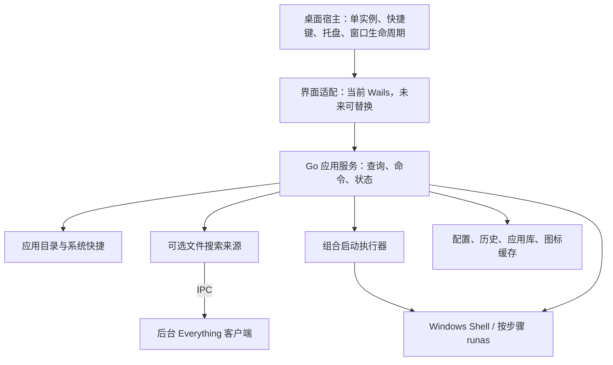

# 架构评估：WebView2、Rust + Slint、Everything 与组合启动

> 2026-10-28 路线更新：已按用户确定的 Rust + Slint 方向创建独立分支与[四阶段实施方案](rust-slint-refactor-plan.md)。本文保留当时的选型依据；后续执行顺序与技术栈以新方案为准，尚不代表已取得 Slint 性能收益。

- 评估日期：2026-10-27（北京时间）。
- 代码依据：工作区 `45dffab` 及当前未提交的测量、基准和文档；应用版本 `0.9.10`。
- 性质：选型建议与重构边界，不代表已完成迁移或已测得候选框架的收益。现有轻量化任务状态仍以[执行文档](lightweight-optimization-plan.md)为准。

## 1. 建议决定

评论关于常驻资源的担忧有实测依据，Everything 文件搜索和组合启动也值得采纳；“因此应该把 Go 全部重写成 Rust”则缺少项目证据。

**当前推荐保留 Go 业务核心，采用进程内的模块化架构，明确桌面宿主、搜索来源和启动执行器的边界。先修复首次启动焦点，再验证 Wails 的后台资源策略；若低内存目标仍无法满足，优先替换常驻界面，而不是同时重写所有业务。**

对非 WebView 界面，优先验证能直接复用 Go 的方案，Gio 是一个候选；Windows 专用的 Win32 界面也是候选，但不能忽略自绘、无障碍和维护成本。Rust + Slint 作为愿意承担完整换栈成本时的备选，通过同等功能原型后再决定。现有数据足以支持开展原型，不足以宣布其中某个工具包已是性能赢家。

若产品把极低后台占用作为不可妥协的定位，长期方向应是**常驻搜索窗口不依赖 WebView**。本轮评估不以几个小型前端优化承诺解决浏览器引擎的固定开销。

## 2. 项目证据

### 2.1 资源压力主要来自 WebView2 子进程

当前是 Go + Wails 2.12 + Vue 3 / TypeScript，Windows 使用系统 WebView2。前端仅有 Vue 一项直接运行依赖；不是内嵌整套 Chromium 的 Electron 发布模式，但运行时仍有浏览器引擎进程。

[受控资源矩阵](baselines/2026-10-27-opt00-controlled/README.md)中，候选程序完整进程树的私有提交中位数如下：

| 状态 | PrivateBytes |
| --- | ---: |
| 可见 | 149.32 MiB |
| 隐藏约 30 秒 | 145.33 MiB |
| 隐藏约 5 分钟 | 138.83 MiB |

在[五分钟组第 2 个样本](baselines/2026-10-27-opt00-controlled/candidate-hidden-5m.json)中，主进程为 30.05 MiB，6 个 WebView2 子进程共 108.78 MiB，占总私有提交约 78.35%。主进程也包含 Wails 宿主等开销，这不是纯 Go 业务内存的测量。

这些是已有的生产模式受控数据，配置为 388 个可见应用、125% DPI，测试副本关闭了自动更新检查。PrivateBytes 是私有提交，不等于物理常驻；进程树 WorkingSet 求和还会重复计算共享页。不能用上述数值直接验收原来的“总常驻 <80 MB”，也不能把不同状态的独立进程差值当成隐藏操作的收益。

### 2.2 搜索内核没有要求换语言的瓶颈

[三轮基准汇总](baselines/2026-10-27-opt00/benchmark-summary.csv)中，1000 应用、带历史记录的 `Service.Search`，各查询场景的中位数约为 0.068–0.210 ms；同规模 `Service.Home` 约为 0.743 ms。这不包含 IPC、窗口激活和绘制，但足以说明不应优先重写搜索算法来解决百 MiB 级的宿主开销。

构建基线中，前端全部产物约 431 KiB，JS 约 148 KiB，Logo 约 258 KiB。缩图、减少重复查询值得做，收益应归入包大小、解码或重复工作，不能等同于移除 WebView2 的收益。

### 2.3 首次启动焦点是先要解决的功能问题

[正式热呼出统计](baselines/2026-10-27-opt00-latency/hotkey-formal-summary.json)有 20 个有效样本及 4 个无效尝试；有效样本中位数 / P95 的保守上界分别为 29.4425 / 51.9961 ms，尚不能宣称 <50 ms 全面达标。

[首次冷启动记录](baselines/2026-10-27-opt00-cold-01/README.md)显示页面日志约 427 ms 就绪，但约 15 秒观察窗口内未确认搜索框可输入，用户也反馈不能直接输入字母。这个失败既不能填成“427 ms 启动成功”，也不能直接归因于 Go 或 Wails 本身。先定位 Windows 激活、WebView 焦点与 DOM 焦点之间的时序，再以修复后的程序身份补测；继续重复相同冷启动失败没有选型价值。

## 3. 评论逐项判断

| 建议 | 判断 | 对 Velo 的落实方式 |
| --- | --- | --- |
| 纯启动器应重视 WebView 占用 | 值得参考 | 当前确有明显固定开销，考察后台生命周期和非 WebView 界面 |
| 改成 Rust | 不是解决问题的必要条件 | 保留 Go 搜索、历史、索引与 Windows 能力，先处理界面宿主 |
| 改成 Slint | 有价值的候选，需要原型 | 验证实际渲染后端、输入法、焦点、DPI、无障碍与资源；不凭 Hello World 数字选型 |
| 集成 Everything | 值得做，可选启用 | 作为文件搜索来源，保留本地应用目录与启动排名 |
| 一键启动多个应用或文件 | 值得做 | 新增轻量组合启动执行器，按步骤选择权限与处理失败 |

### 3.1 Slint 的收益与代价

Slint 不需要浏览器引擎，适合探索低资源界面。但它的“原生”并不保证全部采用 Windows 标准控件，也不保证移除焦点、输入法和系统集成工作。Windows 可使用 Winit，渲染器可选择 GPU 路径或软件路径，必须用具体配置测量。[官方后端说明](https://docs.slint.dev/latest/docs/slint/guide/backends-and-renderers/backend_winit/)

目前官方语言 API 包括 Rust、C++、JavaScript / TypeScript 和 Python，没有 Go。换成 Rust + Slint 意味着重建界面，并迁移 Go 业务，或增加跨语言 / 跨进程边界；后一种方案还要承担协议、生命周期和两套运行时的成本。[官方 FAQ](https://slint.dev/faqs)

Slint 有 GPLv3、Royalty-free 和付费商业选项，不能简单说“必须 GPL 或付费”。Royalty-free 2.0 为桌面应用提供符合归属标识等条件的使用方式，例如 AboutSlint 或下载网页标识；依赖本身也不能因此描述为 MIT。[官方许可条款](https://slint.dev/terms-and-conditions)

### 3.2 可比方案

| 方案 | 复用程度 | 主要价值 | 主要成本 / 判断 |
| --- | --- | --- | --- |
| Go + Wails / Vue，完善后台策略 | 最大 | 最快交付，沿用现有界面和测试 | 浏览器固定开销仍可能妨碍内存目标；是当前维护路线 |
| Go + Gio，替换界面 | 保留大部分 Go 核心 | 移除 WebView，避免改业务语言 | Vue 界面要重建，GPU、输入法、窗口与无障碍需验证；优先原型候选 |
| Go + Win32，必要时自绘结果区 | 保留大部分 Go 核心 | Windows 集成直接，依赖可控 | 布局、视觉、DPI 和 UI Automation 维护成本高；不自动视为最佳 |
| Rust + Slint | 复用规格、数据与测试用例，Go 代码需迁移或桥接 | 单一 Rust / Slint 技术体系，避免浏览器引擎 | 迁移面最大；适用于明确愿意投入一次完整换栈的 2.0 |

[Gio 官方资料](https://gioui.org/)确认其支持 Go 和 Windows，并依赖平台窗口、输入与 GPU 绘制能力。这里将其列为候选，不据此承诺具体内存或把 GPU 绘制视为 Windows 原生控件。

“原生搜索窗 + 按需启动的 Vue 设置进程”可以作为复用设置界面的过渡方案，但会增加 IPC、配置写入协调和两套界面维护。只有需要保留现有设置 UI 时才值得采用；应由 Go 核心独占配置写入，设置进程通过限定命令提交。仅把设置组件改为懒加载，不会释放常驻搜索窗的 WebView2。

## 4. 推荐的内部边界

Velo 自身默认保持一个进程、进程内调用。当前不需要本地 HTTP 服务、微服务或通用插件市场。外部 Everything 维持其自己的生命周期。

已有可复用资产包括 `internal/search`、`indexer`、`history`、`config`、`storage`、`systemtools`、`update` 以及大量 `platform` 代码；主要调整点是：

- `app.go` 同时处理 Wails 事件、快捷键、托盘、窗口与启动操作，适合作为拆分宿主的入口。当前快捷键和托盘在 `OnDomReady` 后注册；如要实现界面按需创建，就要先解除这个生命周期依赖。
- `Service` 已与 Wails 运行时分开，但仍直接使用平台发现能力，`AppItem.IconURL` 也含 Web 界面表示。迁移时在边界注入实际需要的能力，图标核心使用缓存标识 / 路径，URL 留给界面适配器，不必给所有内部函数套接口。
- `Service.Search` 目前同步查询内存，可以保留。新增 Everything 查询采用独立异步路径，再用统一结果类型呈现，不能让外部查询阻塞本地应用结果。
- `platform.Launch` / `LaunchAsAdmin` 保留为执行基础。提取不处理界面显隐的启动执行器，让单项启动和组合启动共用它。

## 5. Everything：新增文件来源，保留应用目录

Everything SDK 是通过 IPC 查询后台 Everything 的包装，不是可直接嵌入、自动替代索引服务的全盘索引库。后台客户端必须运行；仅安装索引服务不能代替查询客户端。其进程和必要服务的开销应单独报告，不能通过外包给它来声称总资源免费降低。[SDK](https://www.voidtools.com/support/everything/sdk/)、[服务说明](https://www.voidtools.com/support/everything/everything_service/)

现有开始菜单、快捷方式参数、Windows Apps、中文别名、拼音、历史权重和噪声过滤都属于应用启动语义，Everything 文件名匹配不能直接替代。

建议实现 `internal/providers/everything`，采用以下边界：

1. 默认应用搜索立即返回。先用 `f 查询词` 之类的显式文件入口，避免文件结果淹没应用；统一混排可在有使用数据后增加。
2. 生产实现使用 Unicode SDK 或明确支持版本的直接 IPC。不要为每个按键启动 `es.exe`；CLI 可以用于接入验证。
3. 限定结果数和分页，按需加载图标并限制缓存，不把数百万路径复制到 Velo 内存。
4. 每次查询带请求序号，旧结果不得覆盖新结果。使用独立工作队列管理查询状态；丢弃旧结果不等于 Everything 的旧查询已被取消，需要明确底层能力和超时行为。
5. SDK 支持非阻塞查询，但要求设置回复窗口并处理回复；不能把阻塞查询搬进 UI 线程。官方将 SDK 描述为线程安全，多调用组成的“设置条件—查询—读取结果”仍应由适配器组织成一笔清晰操作。[查询 API](https://www.voidtools.com/support/everything/sdk/everything_query/)
6. 区分未安装、未运行、数据库未就绪、超时和零结果。此来源不可用时，原有应用搜索仍工作；不自动退化为每次输入全盘遍历。

**需要补足结果与动作模型。** 目前 `Service.Item(id)` 只解析已登记的应用 / 系统项，`AddApplications` 只接受 `.exe` / `.lnk`。Everything 返回的 PDF 或目录不能直接沿用 `Launch(id)` 而不登记解析方式。可新增带来源和种类的结果引用，由后端解析为文件、目录或应用目标，再交给 Windows Shell；不把前端传来的字符串拼成 shell 命令。

## 6. 组合启动：轻量任务列表

现有代码已支持单应用管理员启动，最有价值的增量是保存组合和定义执行语义，而不是先建设通用工作流引擎。

一个“游戏 + YY”组合可以保存两条步骤，每步包含目标引用、参数 / 工作目录、是否启用、权限和可选的启动前延迟；组合级保存顺序和失败时停止 / 继续策略。普通文件使用默认关联程序打开，管理员权限只对明确支持提升的可执行目标提供。

执行器建议放在 `internal/launchgroup`：

- 开始时冻结组合快照，一次隐藏启动器，按顺序发出启动请求；默认不等待第一个应用退出，因此能达到一次操作打开多个应用的效果。
- 不直接循环调用当前的 `App.Launch`：它每次都会隐藏窗口，失败时又显示窗口，还把历史保存失败当作错误返回。组合执行需要独立汇总“启动已受理”和“历史保存失败”。
- 复用 `runas` 逐项请求提升，Velo 本体保持普通权限。多个提升步骤可能分别触发 UAC；不承诺一个弹窗完成全部提升，也不绕过 UAC。
- 明确部分成功、UAC 取消、目标丢失和参数失效；取消组合只取消尚未发出的步骤，不自动结束已经启动的应用。
- 防止双击 / 重复 Enter 重入。启动请求被系统接受不等于程序业务已就绪；固定延迟也不是依赖就绪保证。
- 组合、应用、文件使用明确的目标种类，保存带版本的 JSON 并沿用原子写入。保留现有应用 ID 的身份语义，不在重构时重新生成所有固定项与历史键。

后续有真实需求再增加依赖就绪条件、有限并发或脚本动作。首版的顺序请求、逐项权限、错误策略和执行结果已经能满足评论里的主要场景。

## 7. 执行顺序与选型门槛

1. **先修首次启动焦点并补齐端到端证据。** 用冷启动、普通退出后重开、快捷键、托盘和第二实例验证“无需点击即可输入”。先完成可复现问题的修复，再继续性能统计。
2. **在现有架构消除已知重复工作。** 沿用 OPT-01 的扫描深度剪枝、OPT-03 的刷新合并和隐藏时延后界面更新等任务。当前 `Hide` 是 Win32 `ShowWindow`，隐藏期间 `index:changed` 仍触发前端刷新，产品没有显式后台挂起策略。
3. **限定范围验证 WebView2 生命周期。** 考察隐藏后降低内存目标、闲置后 `TrySuspend`、显示时 `Resume`。暂停不是销毁，不能承诺释放全部浏览器进程；应核对 UI 线程、显隐竞态、未保存设置和更新状态。Wails 2.12 的公开 runtime 没有直接提供这些管理接口，不能当成一个现成配置开关。[微软性能建议](https://learn.microsoft.com/en-us/microsoft-edge/webview2/concepts/performance)
4. **若固定开销仍妨碍产品预算，制作一个非 WebView 的完整关键路径原型。** 优先 Go + Gio；如果愿意评估完整换栈，再加入 Rust + Slint 对照。原型至少含真实中文输入、图标与结果列表、快捷键 / 托盘、显隐、相同索引与排序，不能比较空窗口和完整产品。Win32 路线只有在需要的 Windows 行为或资源指标使它更合适时再投入。
5. **根据结果迁移界面，并独立交付 Everything / 组合启动。** 两项功能与 UI 框架选型解耦；功能需求明确时，可先在当前 Go 架构实现，不必等待迁移。

框架迁移至少应满足：

- 首次及热呼出无需点击即可输入，中文 IME 候选、组合输入期间 Enter / Space 不误触启动。
- 快捷键、失焦隐藏、设置草稿、更新状态、列表 / 网格导航、主题及已有右键能力有对应实现。
- 100% / 125% / 200% DPI、多显示器、屏幕阅读器与键盘操作验证通过。
- 同一机器、数据与负载下记录可见、隐藏 30 秒、隐藏 5 分钟的完整相关进程资源。分别报告 PrivateBytes 与私有工作集，Everything 另列；不以压低工作集显示代替真实收益。
- 延迟以按键 / 进程创建到可输入为边界，保留失败尝试，报告成功率、中位数与 P95。继续对照现有冷启动 <500 ms、热呼出 <50 ms 目标。
- 原“总常驻 <80 MB”须明确物理内存口径后验收；若新增“私有提交 <80 MiB”工程预算，需单列为新指标，不能混同。达到数字之前，不为候选框架填写推测收益。
- 配置、固定项、应用库、历史、更新和单实例行为可迁移，界面重构不要求用户重建个人数据。

本评估支持渐进重构与原型验证，不支持仅凭评论就同时重写语言、搜索、系统集成和界面。对当前 Velo，收益最大的边界是常驻 UI 宿主；值得增加的产品能力是可选文件搜索与可组合启动，两者都能建立在已有 Go 核心之上。
