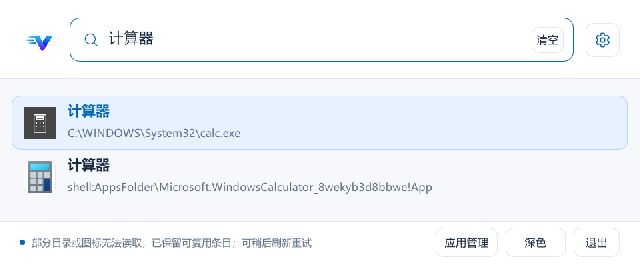
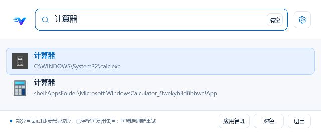
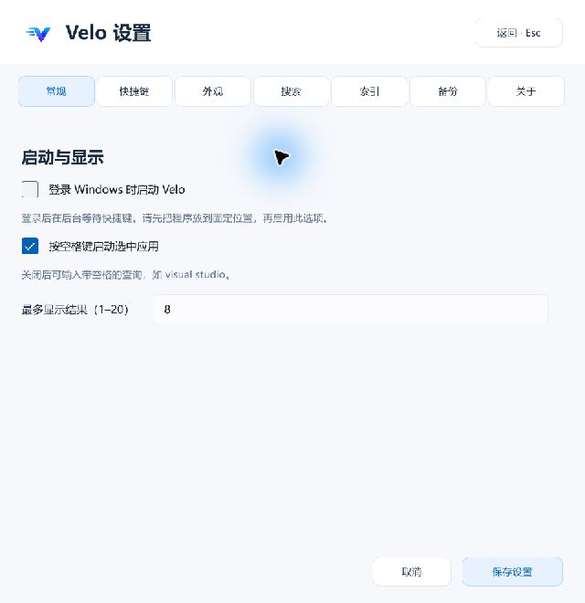
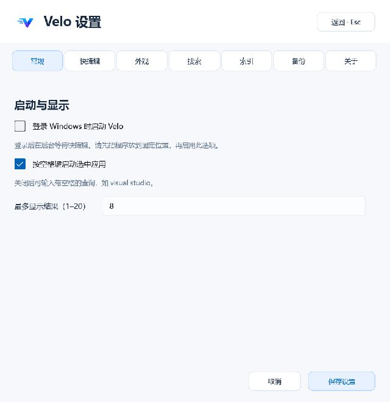

# RS-12 原生 DPI、中文与图标资源观察

2026-11-05（北京时间），复用 RS-12 冻结 Software / FemtoVG Release 和原业务 seed 的全新隔离副本。**本次完成两种 Slint 的有限原生 DPI/中文显示与资源观察，不是完整 DPI/IME/帧耗时验收。** 正式程序、登录项和数据目录未替换。

## 原生 DPI 与实际显示

起止均为两屏 1920×1080、100%（96 DPI），右屏物理原点 `(1920,42)`；通过 Windows 显示设置把右屏临时设为 150%（144 DPI），完成检查后恢复。两种候选均有实际 HWND 的 96→144→96 记录，列表两结果在 96 DPI 为 640×264、144 DPI 为 960×396，设置页在 144 DPI 为 960×990，均位于工作区内。中文“计算器”两项结果、图标与设置页在捕获时可见；工具实际文本送入后，组件日志确认原生/组件焦点、非 IME 合成及字符接收。

- Software：同一进程 PID 318524，原生右屏运行中缩放 100%→150%→100%；恢复后的中文结果截图保留。
- FemtoVG 首轮 PID 330028：右屏变为 150% 时，目标窗口实际留在主屏 96 DPI。原标为 `150-*` 的三份记录明确为无效 DPI 条件，不因截图看起来正常而标为 150% 通过。
- FemtoVG 复验 PID 320796：初始放置后，窗口再次落到主屏；补用既有原生探针 `--move` 将目标 HWND 放到实际 144 DPI 右屏，才取得 960×396 / 960×990 与实际输入记录。该定位是明确的几何注入，不是人工跨屏拖动验收。恢复后实际 DPI 回到 96；最后一次呼出被无关前台活动触发失焦隐藏，未取得恢复窗口截图，保留为截图未完成，不能称为恢复后可见/输入通过。

所有三份 Slint 测试实例通过测试控制入口 `quit` 正常退出，退出码 0、无强制结束、exe SHA 未变。后台扫描各发布 619 项，目录/图标警告保留，最终测量事件没有 `dropped`。完整条件、逐段原生状态及源文件指纹见[汇总](summary.json)和各 run 下的 `identity.json`。

## 短时资源与缓存

每个命令阶段以 100 ms 请求间隔记录约三秒的进程树，实际为每段 28 个完整快照。表中是阶段末 PrivateBytes，既不是三轮 15 秒空闲中位数，也不是 DPI 切换瞬时峰值。显示设置的修改发生在这些阶段之间，CPU 字段只覆盖各命令捕获窗；不能用它排名渲染器或证明高 DPI 动画帧耗时。

| 状态 | Software 私有提交（MiB） | FemtoVG 复验私有提交（MiB） |
| --- | ---: | ---: |
| 96 DPI 中文结果 | 22.762 | 55.707 |
| 实际 144 DPI 中文结果 | 23.621 | 56.512 |
| 实际 144 DPI 设置页 | 26.898 | 67.473 |
| 恢复 96 DPI 后最后观察点 | 22.742（可见） | 71.242（被失焦隐藏） |

两份有效 DPI 轮次的应用图标缓存在预热后均为 26 项，应用 CPU 位图/纹理估算为 **851968 字节**，低于现有 8 MiB 预算。它不包含 Slint 内部字形/图像缓存，不能凭计数不变宣称 GPU 不增长。命令 `warm-bottom` / `warm-top` 是合成可见范围请求，未覆盖完整 619 项图标，也没有证明全部 UI/GPU 引用已淘汰。

Software GPU 提供程序无条目，公开数据保留 `null`。FemtoVG 复验的 96 DPI 中文 / 144 DPI 中文 / 144 DPI 设置 / 恢复后最后点的 GPU Shared 分别约 32.438 / 36.789 / 56.273 / 45.059 MiB，TotalCommitted 约 25.598 / 30.762 / 52.367 / 38.215 MiB，Dedicated 各为 0；不同字段分开保留，不相加为“显存总量”，也不与进程 PrivateBytes 相加。单轮有页面切换与缓存复用，不能据此归因每一字形或断言长期稳定。

原记录的 `100-cold-home` 只是本轮开发标签，启动前已有 seed 图标和系统缓存，**不表示冷图标或严格冷启动**。首次加载/磁盘命中的独立四图标实测继续见上一轮离线证据，不将此阶段改标为新的冷热缓存对照。

## 截图与边界

桌面工具返回的截图按逻辑窗口大小归一化，144 DPI 实际物理大小来自原生记录。归一化截图中的锯齿/裁切外观未做原始物理像素级分析，不当作 RS-13 的 ≤2 逻辑像素或视觉一致验收。设置页未保存草稿，窗口输入未执行应用。

| Software 144 DPI 中文 | FemtoVG 实际 144 DPI 中文 |
| --- | --- |
|  |  |

| Software 144 DPI 设置 | FemtoVG 实际 144 DPI 设置 |
| --- | --- |
|  |  |

这轮文本由 Computer Use 自动送入。Slint 的 `synthetic=false` 仅表示不来自 stdio 控制，不代表物理键盘输入；这里没有新增物理 IME、物理热键或校准延迟证据。截图和命令 ACK 均不能给出输入到结果帧呈现时间，精确延迟、帧耗时、1000/10000 项 UI 呈现矩阵仍待验。

随后准备 Wails 对照实例时，桌面工具被用户的实体 Esc 停止。此后未再发送任何 UI 输入；按 PID/创建时间核对后，经已授权测试探针 `/quit` 正常退出，退出码 0，**没有 Wails DPI/呈现样本**。详情见[中断与退出记录](wails-interrupted.json)。用户明确安排严格冷启动稍后进行；本轮未重启或修改登录项。
