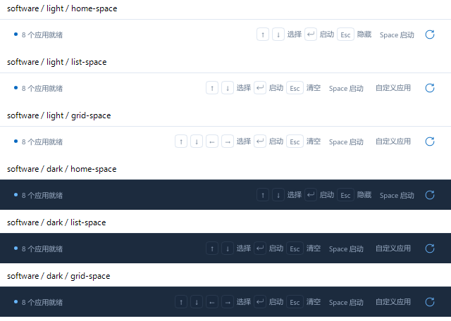
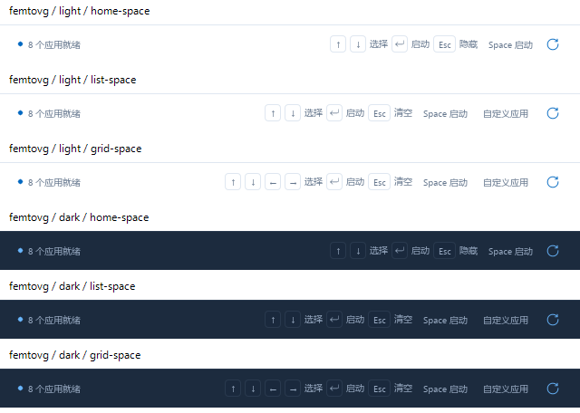

# Velo 0.10.0 名称、托盘和底栏验证

2026-11-16，本地未发布开发快照。基础提交为 `04097d4bac1226531531f98ff6d339366af4ac0d`，含工作区改动；具体源码指纹、两种 exe 的哈希及完整检查回执见 [verification.json](verification.json)。未提交、推送、打包或替换正式安装。

## 修改与结果

- 窗口标题、托盘提示、Windows 产品名称和文件描述统一为 `Velo`。两种实际 exe 的 PE 属性检查通过；渲染器身份保存在 `Comments` 和构建元数据中，关于页的 Slint 许可入口保留。
- 托盘左键根据可见性切换显隐，右键“打开 Velo”仍明确打开。原生消息回归覆盖按下时可见、失焦后隐藏、再收到松开通知的竞态，以及隐藏时打开、键盘激活和 Explorer 恢复。组件回归覆盖设置页与未保存草稿保留、第二次激活隐藏、原生弹窗期间阻止操作，以及连续“打开”保持可见。
- 底栏使用实际宽度布局并统一垂直对齐。修改前在隔离业务实例中复现了开启空格启动后文字偏高，以及搜索页与“自定义应用”重叠。修改后的 FemtoVG 优化构建通过实际窗口截图目视检查；两种渲染器各 58 张合成场景快照，额外覆盖开启空格启动的首页、列表和网格、浅色和深色。

`./scripts/verify-rust.ps1 -Product -SmokeTest` 返回 0。两种渲染器各 88 项 Rust 测试、格式、Clippy、Go/Rust 数据双向兼容、原生接口、Release 构建、PE/CLI 身份、窗口/输入/业务/页面/重启冒烟均通过。拒绝写入用例中的预期错误不表示整轮失败。变更文档链接、差异空白及修改的 PowerShell 脚本语法检查通过。

## 底栏截图

以下拼图从 `rs13_visual` 的 debug 合成截图裁切，依次为浅色首页、列表、网格及深色首页、列表、网格，均开启空格启动。它们说明组件排版，不冒充正式用户数据、物理显示器采样或优化构建的 exe 哈希。

## 范围与清理

宿主机 Windows 11 x64，锁定 Rust/MSVC/SDK，Software 与 FemtoVG。所有业务验证使用独立实例和合成数据。用于实际窗口查看的隔离实例通过正常 quit 退出；初次复现实例在构建前按精确 PID 与命令行识别后终止。检查结束未发现工作区 Velo 测试进程，验证程序均释放托盘与热键。

本轮未复验真实鼠标点击 Windows 托盘、真实 IME、多屏或混合 DPI；托盘行为依据本轮原生消息与组件回归。没有运行 NSIS 或执行正式安装升级。已发布 0.1.0 的资产、授权与旧证据保持原身份。
