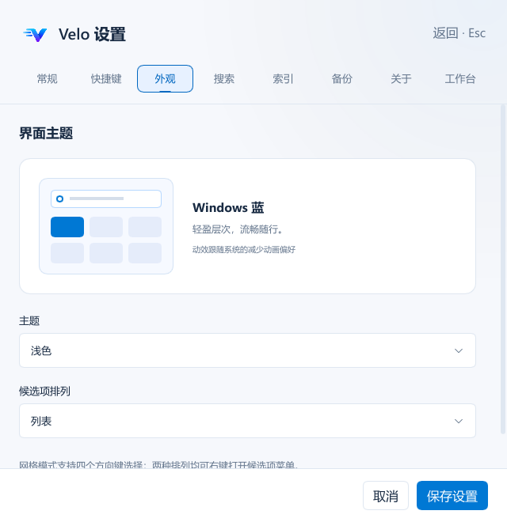
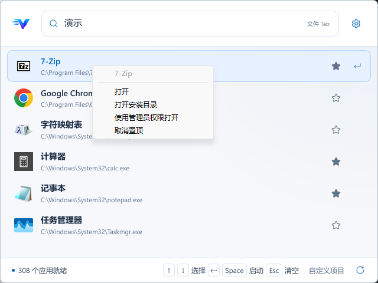
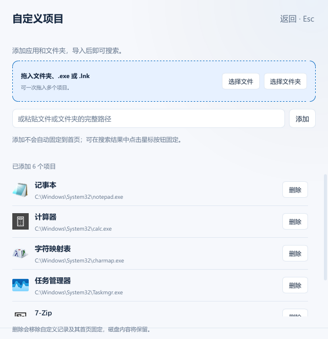
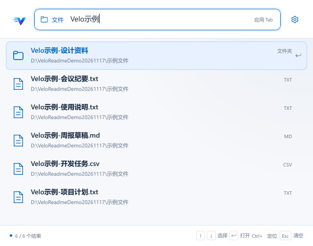
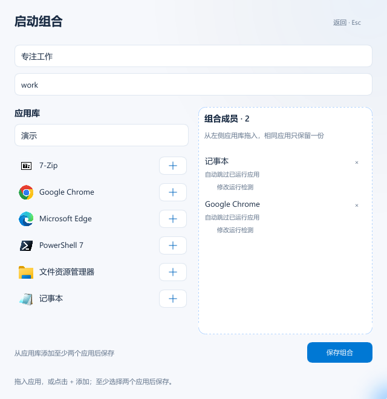
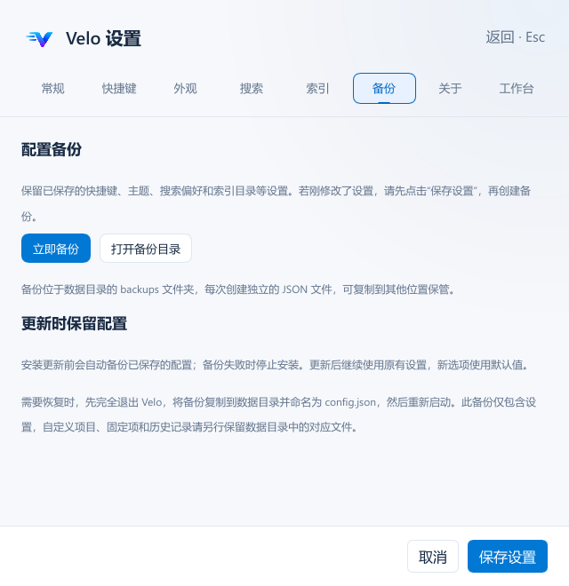

# 用户指南

[返回项目首页](../README.md) · [文档索引](README.md) · [截图说明](images/README.md)

## 安装 Velo

从[最新发布](https://github.com/HBLADEH/velo-launcher/releases/latest)下载 `velo-rust-x64-installer.exe`（Software 默认）并确认 UAC。FemtoVG / OpenGL 替代构建为 `velo-rust-femtovg-x64-installer.exe`，切换前从托盘完全退出。当前提供系统安装版，新安装默认 `Alt+Space` 呼出；已有用户的快捷键继续保留。产品使用 Rust + Slint，界面为简体中文。

本指南适用于 v0.11.0。截图来自 0.11.0 Software 开发构建的真实 Windows 窗口，使用独立演示配置与示例数据。构建身份和采集方式见[截图说明](images/README.md)。

数据保存在 `%LOCALAPPDATA%\Velo`，首次打开前在同级 `VeloRustMigrationBackups` 完整保留原始数据，备份失败则停止初始化。卸载保留数据与程序恢复档案。早期版本用户请先阅读[安装与迁移说明](releases/0.10.0.md)，确认自己的安装方式对应哪条升级路径。

## 移动与隐藏窗口

开发版的主窗口带有随深浅主题变化的细描边。Windows 11 使用系统圆角，Windows 10 显示带细描边的直角窗口。

按住窗口顶部的标志、标题或空白区域拖动即可移动 Launcher，首页、搜索页、设置和自定义应用页面均支持。搜索框和按钮保留原来的输入、点击行为。当前运行期间会保留拖动后的位置，切换页面、刷新索引或隐藏后再次呼出不会重新居中；若屏幕断开或窗口尺寸变大，会将窗口调整到可见工作区域。

点击窗口外部时只隐藏窗口。再次用快捷键或托盘呼出，会回到原来的页面，保留设置分类、尚未保存的修改、搜索内容和更新进度。设置中的“返回 / 取消”、`Esc` 和“保存设置”仍按原来的方式离开设置页；完全退出程序后，下次启动从首页开始。

0.10.0 起，单击托盘图标会切换显示与隐藏：隐藏时点击弹出，显示时再次点击收起。右键菜单的“打开 Velo”始终打开窗口，“设置”打开设置页，“退出”完全结束程序。原生文件选择器或确认框打开期间，先完成或取消弹窗后再切换。

本分支修复托盘关闭时偶发的“隐藏后又出现”：点击托盘时保留本次操作原本的显隐意图，避免任务栏失焦与托盘通知先后到达造成反向切换；尚未包含在已发布的 v0.10.0 中。

下载更新期间可以隐藏窗口，下载继续进行；再次呼出无需重新检查或下载。即使主动离开设置再回来，更新状态也会保留，进行中的更新不会被重复启动。

## 录制全局快捷键

进入 **设置 → 快捷键**，点击快捷键卡片开始录制，然后按下组合键。支持 Ctrl、Alt、Shift 或 Win 搭配字母、数字、Space、Enter、Tab 或 F1–F24。录制成功后会显示按键，点击“保存设置”才会生效。

录制期间按 `Esc` 取消，按 `Tab` 离开控件或切换到其他窗口也会取消；原快捷键继续有效。录制当前已绑定的组合键不会隐藏窗口。系统保留的组合键可能无法录制或注册，被其他程序占用的组合键会在保存时提示。

在 **设置 → 快捷键** 可开启“全屏时禁止快捷键呼出”（默认关闭）。前台应用全屏时不会被呼出窗口打断，仍可通过托盘打开 Velo。该选项保存后生效。

## 选择主题

进入 **设置 → 外观**，打开主题菜单，选择“跟随系统”“浅色”或“深色”。也可使用方向键移动、`Enter` 确认、`Esc` 收起菜单。主题示意图随选择更新，点击“保存设置”后应用到窗口。

## 候选项排列与右键菜单

进入 **设置 → 外观 → 候选项排列**，选择“列表”或“网格”，点击“保存设置”后生效。网格以图标在上、名称在下排列，应用与命中的系统快捷合并展示，统一按搜索排名排序；支持 `↑` / `↓` / `←` / `→` 选择、`Enter` 启动。原有配置默认使用列表。

在首页、搜索列表或搜索网格中右键候选项，可选择“打开”“打开安装目录”“使用管理员权限打开”“置顶 / 取消置顶”。也可按 `Shift+F10` 打开当前选中项的菜单，方向键选择、`Enter` 执行、`Esc` 关闭。置顶与星标固定使用同一份记录，保存到首页并参与搜索排序；取消置顶后仍可搜索。

安装目录取自快捷方式的实际目标。管理员启动保留目标参数和工作目录，并由 Windows 显示 UAC 提示；Windows Apps、设置页及系统操作等不支持的候选项会禁用对应菜单项。

## 添加搜索范围外的应用

点击首页的 **“＋ 自定义应用”**，或进入 **设置 → 索引 → 管理自定义应用**。可以拖入一个或多个 `.exe` / `.lnk` 文件、点击“选择文件”，或粘贴应用完整路径后点击“添加”。管理页面会保持显示，方便切换到资源管理器。

添加后立即加入搜索库，刷新索引或重启 Velo 后仍可搜索，无需把应用所在的整个目录加入扫描范围。列表中的“删除”移除该应用的自定义记录及首页固定，不删除原程序文件；若该应用也在自动扫描范围内，仍可通过自动索引找到。重复添加同一目标与参数不会产生重复项；程序移动后需要重新添加。

添加应用与首页固定独立：新添加的应用不会自动固定，搜索结果旁的星标按钮可将应用固定到首页，取消固定后仍可搜索。自定义应用和固定记录统一保存在 `application-library.json` 中；旧版 `quick-launch.json` 中的手动应用会自动迁移，原文件保留为备份。

搜索优先考虑固定项、启动历史、桌面/开始菜单入口及常见应用，并降低更新服务等辅助程序的排序；精确名称匹配仍优先。常用排序只使用 Velo 的本地启动记录，不读取其他启动器的历史或固定列表。

本分支将“清空回收站”确认框的默认焦点设为“确定”，可直接按 Enter 确认，按 Esc 取消；尚未包含在已发布的 v0.10.0 中。

系统快捷包含 44 个入口定义，会在启动和刷新索引时根据 Windows 版本、本机组件及设置页策略筛选。除计算器、环境变量等常用工具外，还包括管理工具、Windows 设置页，以及清空回收站、关机、重启、锁屏。回收站有内容时显示 Windows 清空确认框；已为空时只提示“回收站已为空，无需清理。”，仅有“确定”按钮，按空格或 Enter 即可关闭。关机、重启先确认且不强制关闭应用；锁屏立即执行。“启动应用”入口管理开机启动应用，Velo 自身的登录启动在设置 → 常规中配置。

首页默认展示 12 项系统快捷，可“展开全部”，支持固定和按使用记录排序。无需固定即可按中文、英文、拼音或缩写搜索，例如 `xt`、`msconfig`、`rwglq`、`hjbl`。名称、关键词和别名均支持中间匹配，关闭模糊搜索时也有效；详见[实现与兼容性说明](system-shortcuts.md)。每次呼出主页立即聚焦搜索框，点击主页内其他区域时保持焦点；有输入时按 `Esc` 清空并回到主页，再按一次隐藏窗口。

## Everything 文件搜索

在 **设置 → 搜索 → 文件搜索** 打开“启用 Everything”，点击“保存设置”。默认关闭；开启后需在当前用户会话运行 Everything 默认实例，只有 Everything 服务运行时仍无法查询。可在设置中选择便携版程序路径，留空时尝试查找标准安装目录。

呼出 Velo 后，在搜索框按 Tab 进入文件模式，再按一次返回应用搜索。两个模式分别保留查询与选中项；文件查询为空时可带入应用搜索词。文件模式支持 Everything 的名称、路径与语法查询，例如 ext:pdf、folder:合同，具体范围由 Everything 自己的索引设置决定。

文件列表显示名称、所在目录和类型。↑ / ↓ 选择，Enter 或双击用默认程序打开，Ctrl+Enter 在资源管理器中定位；右键或 Shift+F10 可复制完整路径。单击只选择。文件模式空格始终用于输入，输入法合成期间不切换模式。设置页及原生弹窗仍保留原有 Tab 行为。

每页加载 50 项，点击“加载更多结果”继续，最多保留 200 项；超出时缩小搜索范围。Esc 先清空查询，再返回应用模式，应用查询为空时隐藏。隐藏后释放文件结果，重新呼出时恢复查询和选择；空闲 30 秒后关闭查询线程。打开失败保留原结果并提示。

未运行或连接失败时可重试、显式启动已有 Everything，或打开官方安装页。关闭开关释放 Velo 的查询资源，Everything 进程继续由用户管理。文件结果不会写入应用库或应用使用历史。见[实现与验收范围](everything-file-search-proposal.md)。

## 启动组合

首页点击“启动组合”，或在“设置 → 索引”中打开“启动组合”，再点击“新建组合”。输入名称，例如“开黑”，在左侧带图标的应用库中搜索或滚动查找应用，将它拖到右侧成员区域，点击“保存组合”。也可点击应用旁的“＋”添加。至少添加两个应用，每组最多 20 个。

别名可不填。添加的成员先留在草稿中，只有保存成功后才生效；重复拖入不会重复添加，返回时会提示保留或放弃修改，切换到其他窗口则保持当前草稿。成员引用现有应用库，不会自动固定到首页。库外程序先通过已有“自定义应用”功能添加，再回到组合中选择。

搜索“开黑”，选择标记为“启动组合”的结果，按 Enter 执行；Space 沿用“空格启动”设置。Velo 一次处理一组，最多同时发出三个启动请求；已经在当前用户和会话中运行的成员会被跳过。某项失败不影响其他成员，也不会关闭已经打开的应用。

再次打开“启动组合 → 查看最近启动”可检查逐项结果、取消尚未派发的成员，或只重新检查/重试未完成项。“已发送启动请求”表示 Windows 接受请求，不表示软件已加载、加速器已完成加速或游戏可以联网。

大多数直接程序和普通快捷方式无需额外设置。对于 Steam 等带参数的游戏入口，在成员下点击“选择运行程序”，选取游戏实际运行的 `.exe` 后保存；启动器进程本身不能证明游戏正在运行。无法确认进程权限时会提示需要确认，可重新检查，或在确认可能重复打开后点击“仍然打开”。启动后暂未观察到进程时也不会自动重复打开。

组合保存在 `launch-groups.json`，不包含在当前只备份设置的“立即备份”中；迁移数据时请一并保留该文件。损坏或未来版本的组合文件会保留原件并停用组合编辑，普通应用仍可搜索和启动。此功能尚未进入已发布的 v0.10.0 安装包，验证范围见[最新实施记录](baselines/2026-11-16-launch-groups-library-only/README.md)。

## 备份与恢复配置

进入 **设置 → 备份**，点击 **“立即备份”**。备份包含已保存的快捷键、主题、搜索偏好、索引目录等 `config.json` 设置；尚未保存的修改请先点击“保存设置”，再重新进入备份页面。

每次备份生成独立的 `config-日期-时间-随机标识.json` 文件，保存到 `%LOCALAPPDATA%\Velo\backups`，不会覆盖此前备份。点击 **“打开备份目录”** 可查看文件或复制到其他位置长期保管。备份保留原配置内容，不会改动当前配置。

恢复时，先从通知区域右键 Velo 托盘图标并选择“退出”，将所需备份复制到 `%LOCALAPPDATA%\Velo` 并重命名为 `config.json`（替换前可另存当前文件），然后重新启动。设置备份不包含自定义应用、固定项、历史记录和缓存；需要迁移这些数据时，请同时保留下面数据表中的对应文件。

## 更新 Velo

设置 → **关于** 中可以立即检查更新；默认也会在启动后自动检查一次，只读取 GitHub 发布页的版本信息，不上传任何本机数据。发现新版本时，窗口底部会出现版本按钮，打开即可查看发布说明、下载并安装。

点击“下载并安装”后 Velo 会退出，由独立脚本完成替换并自动重新启动：

- **Rust 系统安装版**：使用对应渲染器的系统安装包升级，Windows 会提示 UAC 确认；即使当前账户有目录写权限，也使用安装器维持安装回执和恢复档案。

更新器只识别对应渲染器的 Rust 更新资产。当前没有独立免安装版。

下载内容会用发布页 `SHA256SUMS.txt` 中的 SHA-256 校验；校验文件缺失或不匹配时会停止自动安装，只保留手动下载。更新检查可以在设置 → 关于中关闭。

校验通过后，Velo 会先自动备份已保存的配置，备份失败时停止安装并显示原因。更新只替换程序，继续使用数据目录中的原配置；新版增加的设置只在读取时补齐默认值，不改写已有配置文件。自动备份与手动备份存放在同一目录，更新下载清理时会保留。更新前尚未保存的修改需要先手动保存。

更新请求优先使用 `HTTP_PROXY` / `HTTPS_PROXY` 环境变量；未设置对应变量时，使用 Windows 已启用的手动代理，并遵守代理例外列表和 `NO_PROXY`。开启或关闭系统代理后可直接重试，无需重启 Velo。暂不支持自动代理脚本（PAC）及自动发现，可通过 `HTTPS_PROXY` 指定实际代理地址。

GitHub API 按出口 IP 限制请求次数，共享代理节点的额度可能被其他用户耗尽。遇到 `403 API rate limit exceeded` 或 `429` 时，Velo 会自动改读公开发布订阅与文件列表，继续识别预发布版本并校验下载文件，无需配置 GitHub Token。限流恢复前，后续检查也会使用备用通道。若备用通道同样不可用，可切换代理节点、稍后重试，或从发布页手动下载；仍显示原始 403 错误的旧版需要先手动升级。

若下载校验文件或程序时提示连接超时，请检查代理是否可用；也可通过浏览器从 [发布页](https://github.com/HBLADEH/velo-launcher/releases) 手动下载安装包，退出 Velo 后安装，设置与缓存会保留。

## 常见问题

**快捷键没有反应？**

快捷键可能被其他程序占用。通过托盘打开设置，在“快捷键”中更换组合；注册失败时界面会显示提示。

**找不到某个应用？**

在设置 → 索引中检查应用来源，添加应用所在目录，再刷新索引。默认支持 `.lnk` 和 `.exe`，并枚举 Windows Apps。Program Files 默认只扫描浅层主程序；如需辅助入口或深层组件，可关闭“隐藏卸载、帮助、更新等辅助项”。

默认过滤也会隐藏 Program Files 和自定义扫描目录中 `Hypervisor` 子目录下的后台可执行文件（例如 MuMu 的虚拟机、网络与管理组件），保留快捷方式入口。手动添加或固定的组件仍可使用；关闭辅助项过滤可恢复这些自动扫描结果。

**窗口隐藏后程序还在运行吗？**

是。正常模式不显示任务栏按钮，失焦或在输入为空时按 `Esc` 只会隐藏窗口；在通知区域右键 Velo 托盘图标，选择“退出”结束程序。

**数据存在哪里？**

位于 `%LOCALAPPDATA%\Velo`：

| 路径 | 用途 |
| --- | --- |
| `config.json` | 用户设置 |
| `backups/` | 手动及更新前自动生成的配置备份，长期保留 |
| `index.json` | 应用索引与文件指纹缓存 |
| `history.json` | 启动次数、最近使用及查询选择历史 |
| `application-library.json` | 自定义搜索应用及独立的首页固定记录 |
| `launch-groups.json` | 启动组合（v0.11.0 起） |
| `cache/icons/` | 应用图标缓存 |
| `updates/` | 更新时下载的程序文件与替换脚本，完成后自动清理 |
